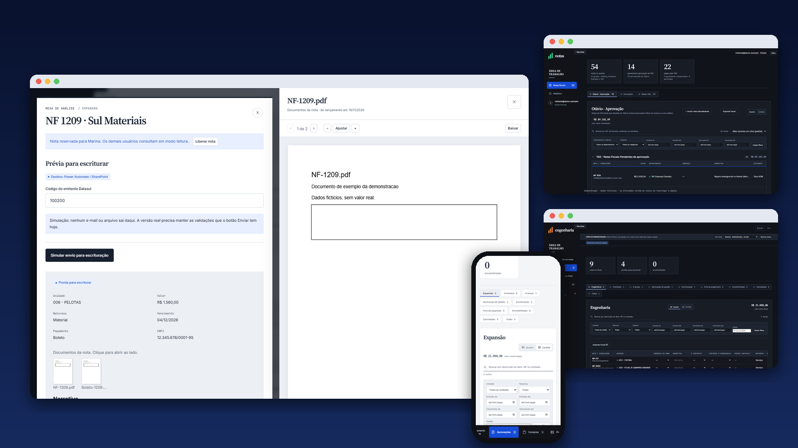
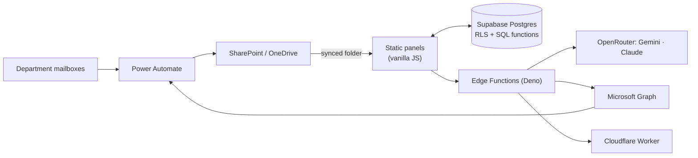

<div align="center">

# Invoice Processing Platform

**From the supplier's e-mail to the accounting entry: automatic intake, AI document reading, multi-stage approval, contracts, purchasing, and a full audit trail.**

I designed and built this accounts-payable system on my own for a company with 21 business units.<br>
It has been in production since July 2026 and is used every day by three departments.

[**▶ Open the live demo**](https://taveshu19.github.io/plataforma-notas-fiscais/) &nbsp;·&nbsp; [Português](README.md)



</div>

> The code, screens and documentation are in **Portuguese** (Brazilian invoices: NF-e, NFS-e, CT-e, boleto). This page is an English summary.

## At a glance

| | |
|---|---|
| **3 panels, one site** | Expansion, Engineering and TAG (an external payer), plus a team portal |
| **800+ documents** | entered by the team by November 2026 (invoices, bank slips, freight documents) |
| **11 approval stages** | each with an owner, rules and an audit trail entry |
| **78 tables, 167 policies** | in two Postgres databases (Supabase), row-level security on every table |
| **18 Edge Functions** | 11 distinct functions in TypeScript (Deno) |
| **15 people, 5 roles** | admin, data entry, engineering, purchasing, TAG |
| **147 releases** | of the intake panel between July and November 2026 |
| **15 days** | from requirements (Nov 5) to full handover (Nov 20), with the in-house approval flow live on Nov 16 |
| **48 automated tests** | approval rules, permissions, automations and storage |

## What it does

1. **Intake.**
   - A Power Automate flow saves e-mail attachments to SharePoint.
   - The browser panel watches the synced folder through the File System Access API.
   - When an e-mail only has a link, a server function downloads the invoice from the city hall website. A Cloudflare Worker is used when a website blocks cloud IPs.
2. **Reading.** The panel tries XML first, then PDF text (PDF.js), then **Gemini** through OpenRouter with a JSON Schema, then OCR. The AI output is checked:
   - CNPJ check digits;
   - number and amount found in the PDF text;
   - amount compared with the bank slip barcode.

   The business unit is set by "votes" on the buyer's tax ID and stays empty unless the votes agree.
3. **Approval workflow.** The stages are: engineering review → contract → purchase order in the ERP → order approval → accounting → sent. Every action is a **Postgres function** that checks:
   - the caller's role;
   - the current stage;
   - the required fields;
   - an optimistic-concurrency version.

   It then appends a timestamped line to the note's history.
4. **Accounting dispatch.** Rule-based routing by unit, nature and payer:
   - SharePoint, through an e-mail caught by a flow in the sender's own account;
   - e-mail to the unit's tax clerk;
   - a finance spreadsheet.

   E-mails go through Microsoft Graph, with a preview mode. Re-sending is only allowed for rejected and corrected notes.
5. **Round trip.** The ERP's approval robot sends an e-mail. A flow posts it to an Edge Function, which parses it and records the result idempotently.
6. **Modules:**
   - contracts with remaining balance;
   - purchasing with SLA, KPIs and e-mails that carry the attachments;
   - projects and activities boards;
   - the TAG panel, with its own approver and automations;
   - a work-control tab.
7. **AI assistant (Claude).**
   - It investigates the database with a **read-only Postgres role**.
   - It can only *propose* changes. A proposal is dry-run inside a rolled-back transaction, shown as before and after, and executed with a separate role only after a human confirms.
   - A trigger stores the previous row for undo. Proposals expire after 15 minutes.

## Architecture



Some design decisions:
- **Business rules live in the database** as `SECURITY DEFINER` functions, so the same rules apply to the UI, the assistant and scripts.
- **One data interface, two implementations.** An in-memory fake database powers the demo, and a Supabase adapter powers production. Every change was validated with users on the demo first, with the same UI code.
- **No rewrite.** The original 16k-line panel is extended by build scripts that patch **exact code anchors** and fail loudly if an anchor is missing or duplicated.
- **Locked-down demo.** The CSP blocks all network connections (`connect-src 'none'`), and the build fails if any production URL or key appears in the output.

## Highlights

- Duplicate-proof intake: a SHA-256 hash is registered in a unique column **before** the file is read, so the database decides concurrent races.
- A **shadow mode** measured whether automatic sending would have been correct for about three weeks before turning it on.
- A migration off a SaaS work-management tool (Monday.com) in 15 days:
  - board mirrors inside Postgres;
  - a parity audit;
  - file copies, because the tool's file links expire within hours;
  - backups and rollback points;
  - a full cut-over.
- Security: RLS on all 78 tables, secrets only in function secrets and Vault, rate-limited password recovery that doesn't reveal whether an account exists, and AI calls restricted to providers that don't retain data.

## Run it

Node.js 22 only, no dependencies:

```bash
node codigo/montar-demo.mjs   # builds demo/
npx serve demo
cd codigo/site && node --test copia-painel/requisitos.test.cjs
cd codigo/tag/notas-fiscais && npm test
```

## About this repository

This is the production code with names replaced:
- The company, people, units, addresses, tax IDs and suppliers were swapped for fictitious ones by a consistent script, so the build scripts and tests still work.
- There is no real data, key or production endpoint in the repository.

Author: **Gustavo Oliveira**. I used coding agents (Claude Code, Codex) as development tools, working from my specifications and under my review.

License: all rights reserved, published for reference and portfolio purposes (see [LICENSE](LICENSE)).
