<div align="center">

# Plataforma de Notas Fiscais

**Do e-mail do fornecedor até a escrituração: entrada automática, leitura com IA, aprovação em etapas, contratos, compras e o histórico de cada passo.**

Projetei e construí sozinho este sistema de contas a pagar para uma empresa com várias unidades.<br>
Está em produção desde julho de 2026 e é usado todos os dias por três áreas.

[**▶ Abrir a demonstração**](https://taveshu19.github.io/plataforma-notas-fiscais/) &nbsp;·&nbsp;
[Arquitetura](docs/02-arquitetura.md) &nbsp;·&nbsp;
[O caminho de uma nota](docs/03-fluxo-da-nota.md) &nbsp;·&nbsp;
[Linha do tempo](docs/14-linha-do-tempo.md) &nbsp;·&nbsp;
[English](README.en.md)


-8A2BE2)


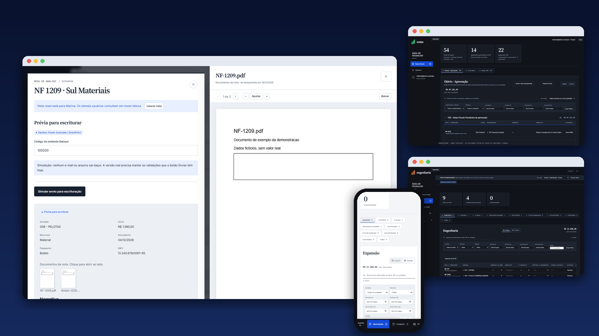

</div>

---

## Em números

| | |
|---|---|
| **3 painéis num endereço só** | Expansão, Engenharia e TAG, com o portal de equipes e o Controle de Lançamentos |
| **Mais de 800 documentos** | lançados pela equipe até novembro de 2026, entre notas, boletos, CT-e e faturas |
| **11 etapas** | de aprovação, cada uma com responsável, regra e registro no histórico |
| **78 tabelas, 167 políticas** | em dois bancos Postgres (Supabase). Todas as tabelas com segurança por linha (RLS) |
| **18 Edge Functions** | 11 funções diferentes, em TypeScript (Deno), publicadas nos dois bancos |
| **15 pessoas, 5 perfis** | administração, equipe de lançamento, engenharia, compras e TAG |
| **147 versões** | do painel de lançamento publicadas entre julho e novembro de 2026 |
| **15 dias** | entre o levantamento (05/11) e a entrega completa ao responsável seguinte (20/11), com o fluxo de aprovação próprio no ar desde 16/11 |
| **48 testes automatizados** | regras de aprovação, permissões, automações da TAG e armazenamento |

## O que o sistema faz

1. **Recebe a nota sozinho.** O fornecedor manda o e-mail. Um fluxo do Power Automate salva os anexos numa pasta do SharePoint, e o painel percebe o arquivo novo. Quando o e-mail traz só um link, o sistema baixa a nota no site da prefeitura.
2. **Lê a nota.** Primeiro o XML, depois o texto do PDF e, por último, a IA (Gemini). O painel confere o que a IA leu: dígito do CNPJ, número e valor no texto do PDF, valor do boleto e unidade pelo CNPJ de quem comprou. O que não bate vira aviso para a pessoa conferir.
3. **Leva a nota pelas etapas de aprovação.** A nota passa por análise da engenharia, contrato, pedido no ERP, aprovação do pedido, escrituração e encaminhamento, uma etapa por vez. Cada perfil vê e faz só a sua parte. Toda ação fica no histórico da nota.
4. **Envia para escriturar.** Pode ser uma nota ou um lote. O destino depende de regras: SharePoint (por um fluxo na conta de quem enviou), e-mail ao fiscal da unidade ou planilha do financeiro. Os anexos vão sem repetição.
5. **Recebe a resposta de volta.** Quando o robô de aprovação do ERP manda o e-mail de pedido "Aprovado" ou "Rejeitado", a resposta entra sozinha na nota.
6. **Tem módulos em volta:**
   - **Contratos**, com saldo e aditivos;
   - **Compras**, com requisições, cotação, prazos (SLA), indicadores e e-mails com os anexos;
   - **Projetos e Atividades**;
   - **painel da TAG**, para as notas de um dos pagadores, com automações e aprovação própria;
   - **Controle de Lançamentos**.
7. **Responde dúvidas com o Claude.** Um assistente dentro do painel investiga o banco (só lendo) e responde dúvidas como "o que aconteceu com a nota 1234?". Ele pode **propor** correções, que só são feitas depois que a pessoa confirma, e podem ser desfeitas.

## Telas

> Todas as telas são da [demonstração](https://taveshu19.github.io/plataforma-notas-fiscais/), com **dados fictícios**. Empresa, pessoas, unidades e endereços foram trocados. Em cada painel, "Ver como" troca o perfil.

| | |
|---|---|
| 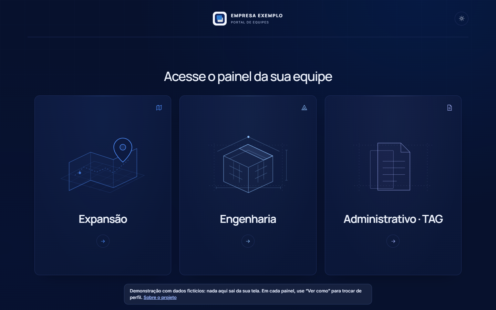 **Portal de equipes.** Um endereço para os três painéis | 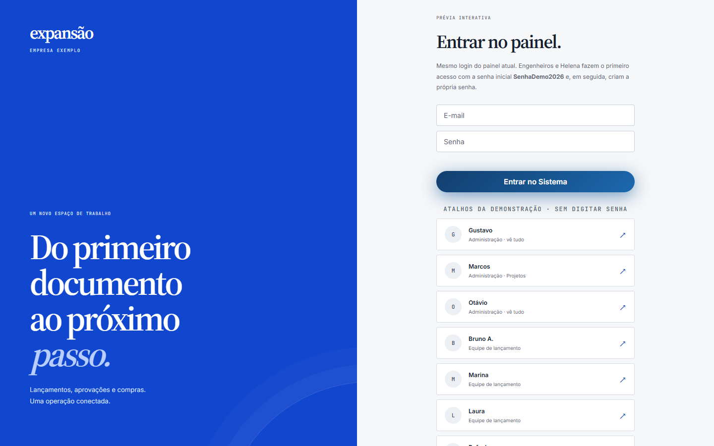 **Entrada.** Login igual nos painéis; na demonstração, atalhos por perfil |
| 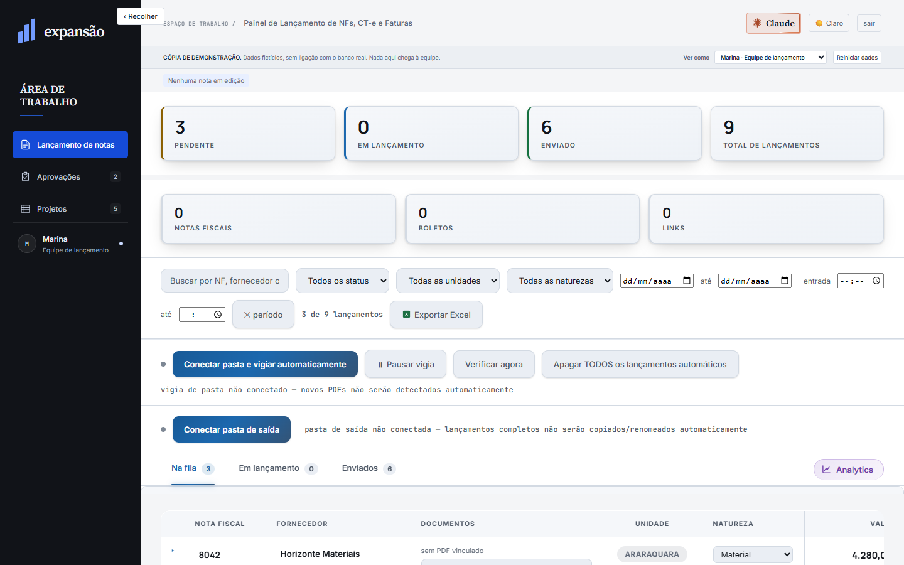 **Lançamento.** Fila do que chegou na pasta, já lido, com indicadores e filtros | 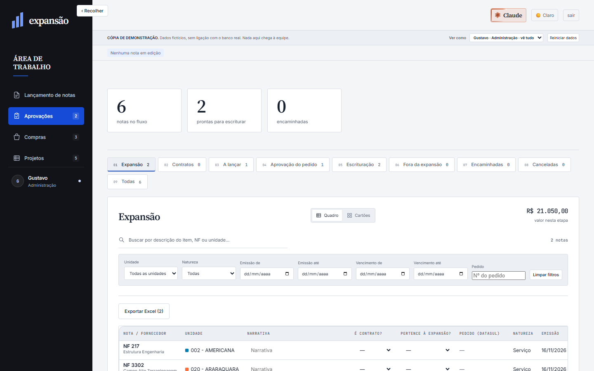 **Aprovações.** As etapas viram abas, com contagem e valor de cada uma |
| 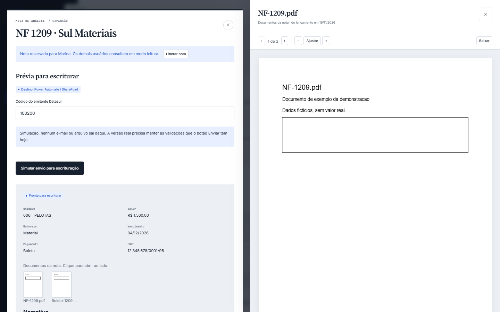 **Mesa de análise.** Nota e documento lado a lado. Quem abre a nota fica com ela, e os outros só leem | 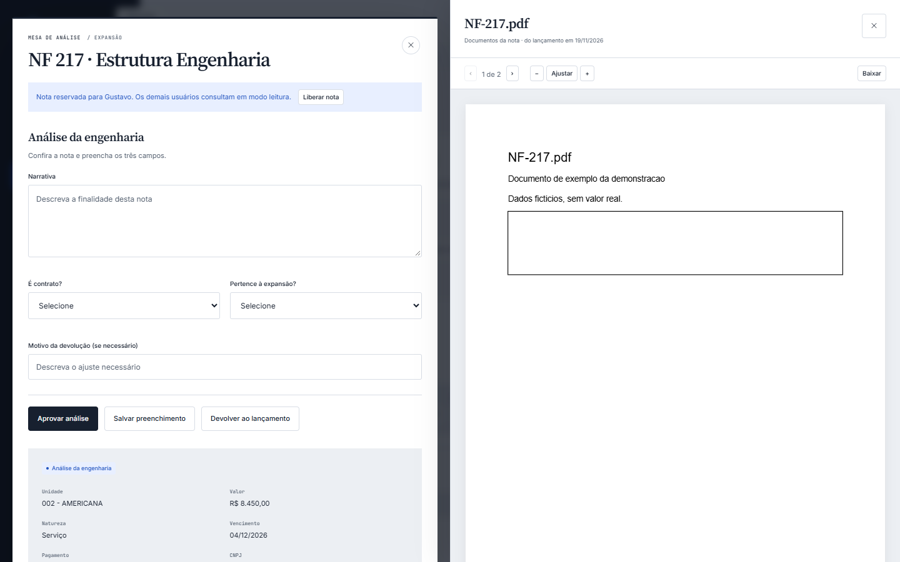 **Análise da engenharia.** Três campos e três saídas: aprovar, salvar ou devolver com motivo |
| 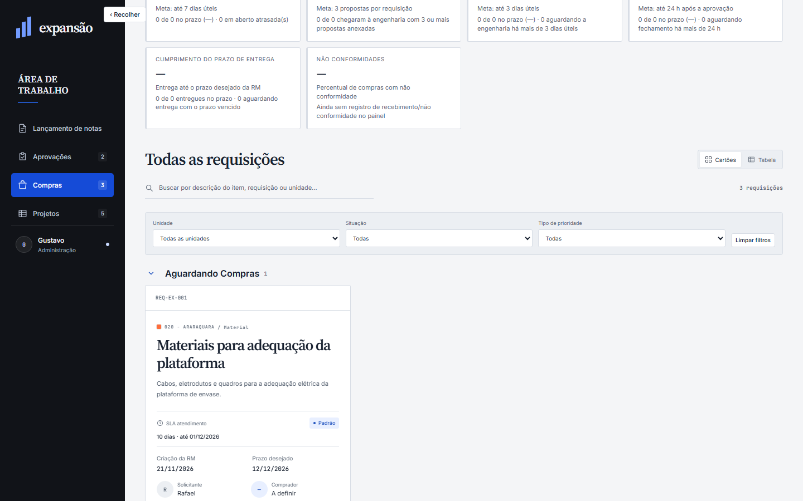 **Compras.** Fases, metas do procedimento e cartões com SLA, solicitante e anexos | 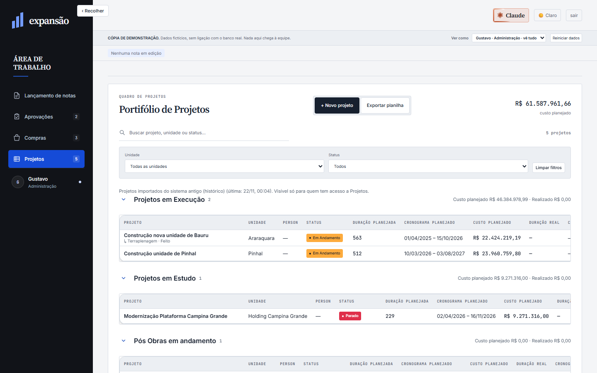 **Projetos.** Quadro por grupo, com custo planejado e real |
| 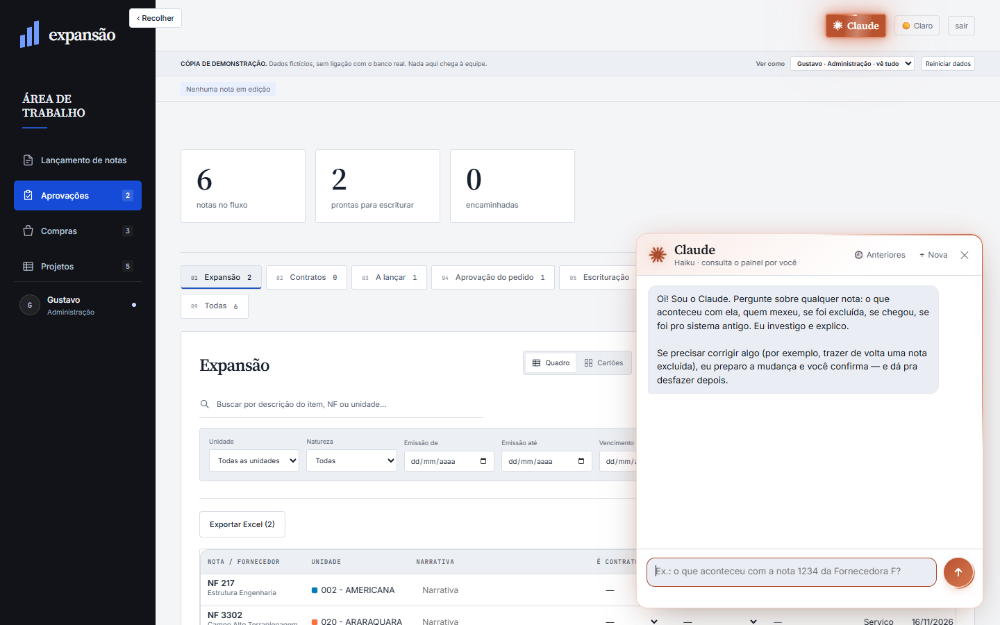 **Assistente (Claude).** Investiga o banco e cita a fonte, sem alterar nada sozinho | 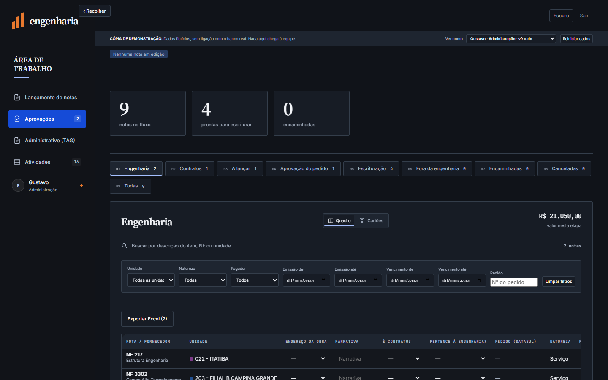 **Engenharia.** O mesmo fluxo com outras regras (Pagador, endereço da obra), em laranja |
| 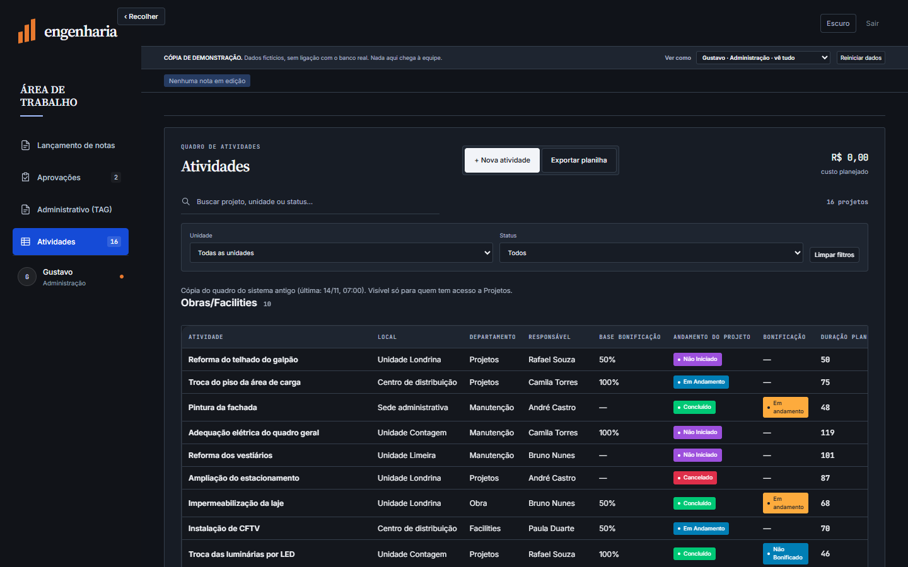 **Atividades da engenharia.** Quadro com cronograma, responsável e bonificação | 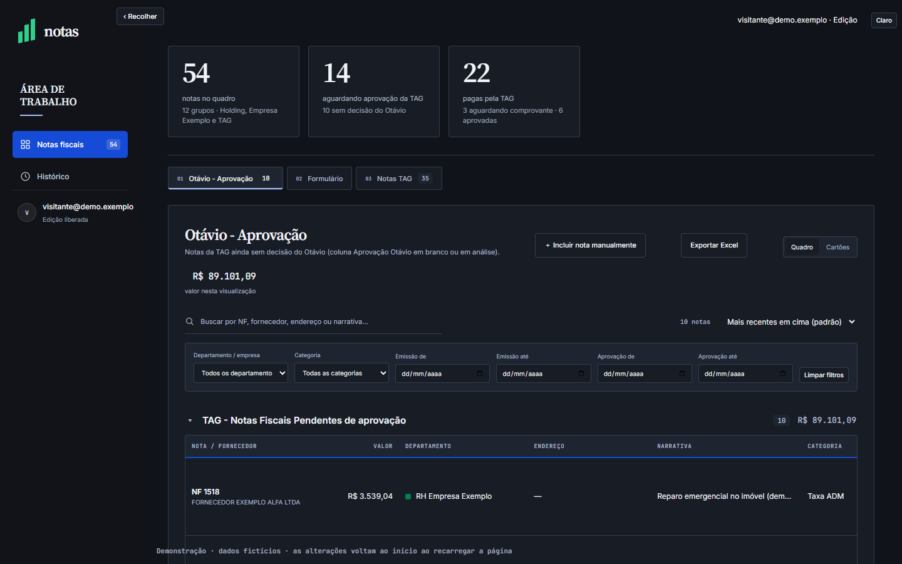 **Painel da TAG.** Abas por empresa, aprovação própria e automações |

<p align="center">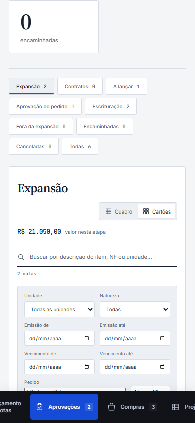<br><b>No celular.</b> Menu embaixo, etapas em botões e notas em cartões.</p>

O começo da fase 2 está na [proposta navegável de 05/11](https://taveshu19.github.io/plataforma-notas-fiscais/proposta.html). Ela foi mostrada às equipes antes de qualquer código de produção ([como foi a migração](docs/12-migracao.md)).

## Arquitetura

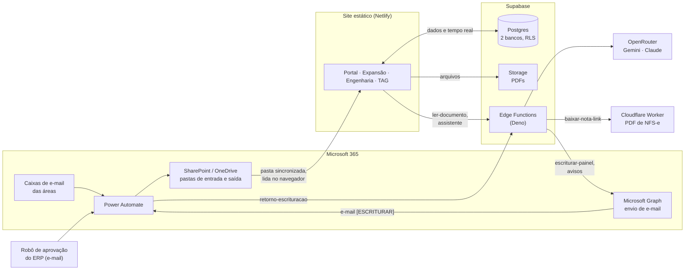

- **Front:** páginas únicas em HTML e JavaScript puro, sem framework e sem etapa de build no navegador. As partes novas entram no painel original por **geradores com trechos exatos**: se o original mudar, a montagem para em vez de gerar um painel quebrado ([como funciona](docs/11-build-testes-e-deploy.md)).
- **Banco:** Postgres no Supabase, com login, tempo real, armazenamento de arquivos e **RLS em todas as tabelas**. Quem pode o quê está no banco, e não só na tela ([banco](docs/06-banco-de-dados.md), [segurança](docs/08-seguranca-e-privacidade.md)).
- **Servidor:** 11 Edge Functions guardam as chaves e fazem o que o navegador não pode: chamar a IA, baixar PDF de prefeitura (sem CORS), mandar e-mail pelo Microsoft Graph e receber o retorno do robô ([funções](docs/07-funcoes.md)).
- **Microsoft 365:** o Power Automate faz a ponte com o que a empresa já usava (caixas de e-mail, SharePoint, lista da escrituração).

## O caminho de uma nota

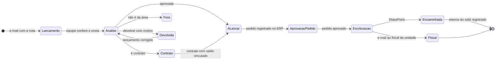

Em qualquer etapa a nota pode ser **cancelada**, sempre com motivo. Na Engenharia, a nota com Pagador TAG vai para o painel da TAG. Regras, perfis e exceções estão em [O caminho de uma nota](docs/03-fluxo-da-nota.md).

## Destaques técnicos

- **Ninguém lança a mesma nota duas vezes.** Antes de ler, o painel grava a impressão digital (hash) do arquivo numa coluna que não aceita repetição. Se duas pessoas pegam o mesmo arquivo ao mesmo tempo, quem decide é o banco ([entrada e leitura](docs/04-entrada-e-leitura.md)).
- **A IA não é aceita sem conferência.** A resposta segue um JSON Schema e passa por verificações: dígito do CNPJ, valor contra a linha digitável, número e valor no texto do PDF. A unidade sai por "votos" do CNPJ do tomador, e a tabela verificada também vota; com voto contrário, o campo fica vazio, porque unidade errada é pior que vazia.
- **PDF de prefeitura sem CORS e com bloqueio de nuvem.** Uma Edge Function baixa a nota. Um portal municipal bloqueava os endereços da AWS, onde a função roda; a solução foi um Worker na Cloudflare que busca o arquivo e o devolve como PDF.
- **Uma nota, uma pessoa por vez.** Quem abre a nota fica com ela, e os outros veem em modo leitura. Quem fica com a nota é decidido pelo banco, e não pelo navegador.
- **Escrituração por regras.** A escrituração segue a natureza da nota, a unidade e o pagador. Os e-mails saem pelo Microsoft Graph e os anexos vão sem repetição. Há um modo prévia, que manda tudo para um endereço de teste, e o reenvio só é aceito para nota recusada e corrigida ([escrituração](docs/05-escrituracao.md)).
- **Assistente com travas no banco, não no prompt.**
  - Ele lê com um papel do Postgres que só pode consultar (`SELECT`).
  - Para corrigir algo, ele **propõe**. A proposta roda num ensaio desfeito no final, a pessoa confirma, e só então a mudança é feita, com outro papel. Um gatilho guarda o "antes" para desfazer.
  - Detalhes em [assistente com IA](docs/09-assistente-com-ia.md).
- **Demonstração isolada por CSP.** A demonstração é o mesmo código da produção, com um banco falso na memória da página. A política de segurança do navegador (`connect-src 'none'`) impede qualquer conexão de rede, e a montagem para se encontrar endereço do ambiente real no resultado.
- **Migração do Monday.com sem parar o trabalho.**
  - Espelhos dos quadros no banco e auditoria de paridade, item por item.
  - Cópia dos arquivos e virada no dia 16/11.
  - Corte de todos os vínculos no dia 19/11. A ferramenta antiga virou só histórico ([migração](docs/12-migracao.md)).

Os problemas reais e como foram resolvidos estão em [Desafios e lições](docs/13-desafios-e-licoes.md).

## Tecnologias

| Camada | O que foi usado |
|---|---|
| Interface | HTML, CSS e JavaScript puro (ES2022); PDF.js; SheetJS (Excel); File System Access API (leitura da pasta); tema claro e escuro; versão para celular |
| Banco e servidor | Supabase: Postgres, Auth, Realtime, Storage, Vault, gatilhos e funções SQL, `pg_net` e Edge Functions em Deno/TypeScript |
| IA | Gemini Flash (leitura dos documentos) e Claude (assistente), pelo OpenRouter, com saída estruturada, modelo de reserva e provedores que não guardam dados |
| Integrações | Power Automate, SharePoint/OneDrive, Microsoft Graph (Entra ID), Cloudflare Workers e o ERP TOTVS Datasul (pedido) |
| Publicação | Netlify (produção) e GitHub Pages com GitHub Actions (demonstração e testes) |
| Testes | `node:test`: 48 testes de regras, permissões, automações e armazenamento |

## Estrutura do repositório

```
├── README.md                 ← você está aqui
├── docs/                     ← documentação técnica (15 documentos) e imagens
├── codigo/
│   ├── paineis-originais/    ← painel de lançamento (Expansão e Engenharia) e o Worker da Cloudflare
│   ├── site/
│   │   ├── copia-painel/     ← Aprovações, Contratos, Compras, Projetos, regras e testes (+ banco falso da demonstração)
│   │   ├── copia-engenharia/ ← gerador da Engenharia a partir do mesmo código
│   │   ├── producao/         ← geradores e adaptadores do banco real, Controle de Lançamentos
│   │   ├── integracao/       ← camada de interface (navegação, fila de decisões, temas)
│   │   └── publicados/       ← montagem do site oficial (menu + 3 painéis)
│   ├── tag/                  ← painel da TAG: tela, regras, automações, servidor local e testes
│   ├── funcoes/              ← 18 Edge Functions (Supabase), como estavam no ar
│   ├── banco/                ← estrutura dos dois bancos (tabelas, RLS, funções SQL, gatilhos), sem dados
│   ├── menu/                 ← portal de equipes
│   └── montar-demo.mjs       ← monta a demonstração em demo/
└── .github/workflows/        ← testes e publicação da demonstração
```

## Como rodar

Precisa só do **Node.js 22**. Não há dependências para instalar.

```bash
# demonstração (gera demo/ a partir do código)
node codigo/montar-demo.mjs
npx serve demo            # ou qualquer servidor estático

# testes
cd codigo/site && node --test copia-painel/requisitos.test.cjs
cd codigo/tag/notas-fiscais && npm test
```

Para ligar a um banco de verdade, cada painel precisa do endereço e da chave pública de um projeto Supabase seu. As funções precisam dos segredos listados em [Funções](docs/07-funcoes.md).

## Documentação

| | |
|---|---|
| [01 · Contexto e resultado](docs/01-contexto-e-resultado.md) | O problema, quem usa e o que mudou |
| [02 · Arquitetura](docs/02-arquitetura.md) | Peças, decisões e por quê |
| [03 · O caminho de uma nota](docs/03-fluxo-da-nota.md) | Etapas, perfis e regras |
| [04 · Entrada e leitura](docs/04-entrada-e-leitura.md) | Do e-mail à fila, XML, PDF, IA e validações |
| [05 · Escrituração](docs/05-escrituracao.md) | Roteamento, e-mails e retorno do robô |
| [06 · Banco de dados](docs/06-banco-de-dados.md) | Modelo, RLS, perfis, gatilhos e cofre |
| [07 · Funções](docs/07-funcoes.md) | As 11 Edge Functions, uma a uma |
| [08 · Segurança e privacidade](docs/08-seguranca-e-privacidade.md) | Como o acesso é garantido e o que foi anonimizado aqui |
| [09 · Assistente com IA](docs/09-assistente-com-ia.md) | Agente com ferramentas e travas no banco |
| [10 · Módulos](docs/10-modulos.md) | Contratos, Compras, Projetos, TAG e Controle de Lançamentos |
| [11 · Build, testes e publicação](docs/11-build-testes-e-deploy.md) | Geradores com âncoras, demonstração isolada e testes |
| [12 · Migração](docs/12-migracao.md) | Da ferramenta SaaS para o sistema próprio |
| [13 · Desafios e lições](docs/13-desafios-e-licoes.md) | Problemas reais e como foram resolvidos |
| [14 · Linha do tempo](docs/14-linha-do-tempo.md) | De julho a novembro de 2026 |
| [15 · Como eu trabalhei](docs/15-como-eu-trabalhei.md) | Levantamento, entregas diárias e uso de agentes de IA |

Estudos de caso no meu portfólio: [plataforma de notas](https://github.com/Taveshu19/portfolio/blob/main/casos/01-plataforma-notas-fiscais.md) · [leitura com IA](https://github.com/Taveshu19/portfolio/blob/main/casos/02-leitura-de-documentos-com-llm.md) · [assistente](https://github.com/Taveshu19/portfolio/blob/main/casos/03-assistente-de-ia-com-acesso-ao-banco.md) · [integração com o ERP](https://github.com/Taveshu19/portfolio/blob/main/casos/04-integracao-com-erp.md).

## Sobre este repositório

- **O código é o que roda em produção**, com uma única diferença: os nomes foram trocados. A empresa virou "Empresa Exemplo" e o grupo, "Holding". As pessoas, as unidades, os endereços, os CNPJs e os fornecedores também receberam nomes fictícios. A troca foi feita por script, de forma consistente, e por isso os geradores e os testes continuam funcionando.
- **Nenhum dado real.** Não há notas, valores, cadastros, senhas, chaves ou endereços do ambiente real. Os projetos do Supabase aparecem como `seu-projeto-expansao` e `seu-projeto-engenharia`.
- Os comentários do código citam o Monday.com porque ele foi o sistema anterior. Nas telas da demonstração, como na produção, ele não aparece mais.

## Autor

**Gustavo Oliveira**: análise, levantamento com as equipes, arquitetura, banco, funções, telas, automações, publicação e suporte.

Usei agentes de IA no terminal (Claude Code e Codex) como ferramenta de desenvolvimento, a partir das minhas especificações e com a minha revisão. Mais em [Como eu trabalhei](docs/15-como-eu-trabalhei.md) e no meu [perfil](https://github.com/Taveshu19).

## Licença

O código está publicado para consulta e portfólio. **Todos os direitos reservados** (veja [LICENSE](LICENSE)). Para usar alguma parte, fale comigo.
