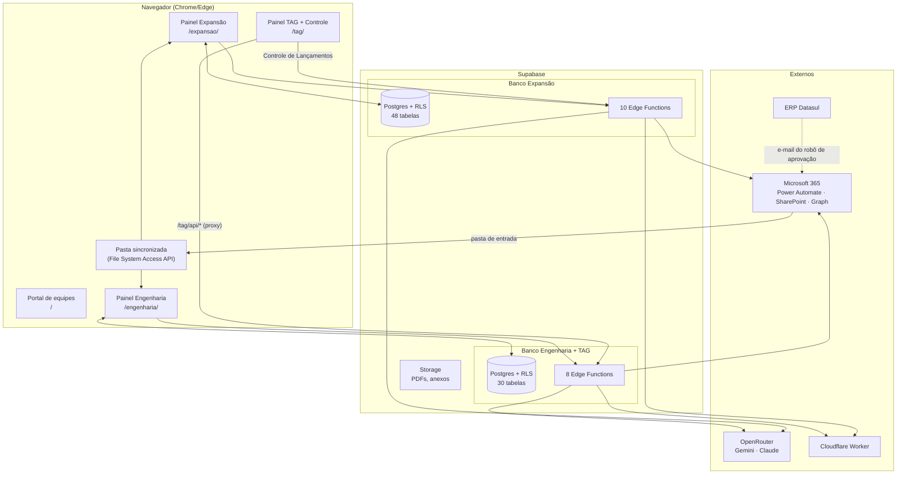
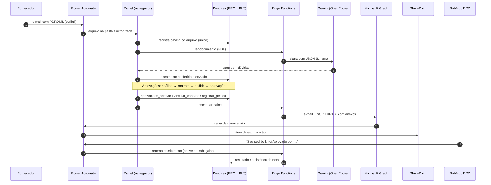

# 02 · Arquitetura

## Visão geral



## As peças

| Peça | Tecnologia | Papel |
|---|---|---|
| Painéis | HTML + JavaScript puro, uma página por painel | Lançamento, aprovações, contratos, compras, projetos e assistente |
| Portal | HTML estático | Entrada única dos três painéis |
| Banco | Supabase (Postgres, Auth, Realtime, Storage, Vault) | Dados, regras de negócio (funções SQL), permissões (RLS), tempo real |
| Funções | Supabase Edge Functions (Deno/TypeScript) | Tudo que precisa de chave secreta ou rede livre: IA, e-mail, download de notas, API da TAG |
| Ponte com o Microsoft 365 | Power Automate | Salvar anexos dos e-mails, criar o item da escrituração no SharePoint, ler o e-mail do robô |
| E-mail | Microsoft Graph (app no Entra ID) | Escrituração, avisos de Compras, recuperação de senha, reprovação na TAG |
| IA | OpenRouter (Gemini Flash e Claude) | Leitura dos PDFs e assistente |
| Baixador | Cloudflare Worker | PDF de prefeituras que bloqueiam a nuvem onde as funções rodam |
| Publicação | Netlify (site oficial) e GitHub Pages (demonstração) | Site estático; `_redirects` leva `/tag/api/*` para a função `tag-api` |

## Decisões e por quê

### 1. Regra de negócio no banco, não na tela

Toda ação que muda uma nota é uma **função SQL** (`SECURITY DEFINER`), chamada pelo painel por RPC. Exemplos: `aprovacoes_aprovar`, `aprovacoes_devolver`, `aprovacoes_vincular_contrato`, `aprovacoes_registrar_pedido`, `compras_mover` e `contratos_criar`.

Cada função faz, na ordem:
1. descobre **quem** está chamando, pelo login;
2. confere se o **perfil** pode fazer aquilo;
3. confere se a nota **ainda está na etapa** em que a pessoa a viu;
4. confere se os **campos obrigatórios** estão preenchidos;
5. confere a **versão**, para recusar a gravação se outra pessoa alterou a nota antes;
6. grava a mudança e acrescenta uma **linha no histórico**, com data, hora e nome.

```sql
-- trecho de aprovacoes_aprovar (codigo/banco/esquema-expansao.sql)
if eu.equipe is null or eu.equipe not in ('expansao','admin') then raise exception 'Só a engenharia aprova a análise.'; end if;
if ctx.eff <> 'engenharia' then raise exception 'Esta nota já avançou e não está mais na engenharia.'; end if;
novo := case when r.expansao = 'Não' then 'fora' when r.contrato = 'Sim' then 'contrato' else 'pedido' end;
update public.aprovacoes_notas set etapa = novo, historico = historico || jsonb_build_array(linha), versao = versao + 1 ...
```

**Por quê:** a tela pode ter erro, pode estar desatualizada ou pode ser contornada. O banco não. A mesma regra vale para quem usa o painel, para o assistente de IA e para qualquer script.

### 2. Uma interface de dados, duas implementações

As telas novas (Aprovações, Compras, Contratos, Projetos) conversam com um único objeto, `window.ExpansaoDados`. Ele tem duas implementações:
- `copia-painel/demo-banco.js`: banco **falso**, na memória da página, com dados fictícios e controles de demonstração ("Ver como", "Reiniciar dados");
- `producao/homologacao/adaptador-producao.js`: o banco **real**, pelo supabase-js, com RPC, Realtime e Storage.

**Por quê:** cada mudança foi validada com as equipes na demonstração, com o mesmo código da tela, antes de ligar ao banco real. A demonstração deste repositório é exatamente isso.

### 3. Evoluir o painel original com geradores, sem reescrever

O painel de lançamento é uma página de cerca de 16 mil linhas, em produção desde julho. Ele não foi reescrito. Os geradores (`montar.mjs`) leem o original e montam o painel final:
- trocam **trechos exatos** do código;
- injetam os módulos novos (CSS e JS);
- trocam a camada de dados.

Cada troca exige encontrar o trecho exatamente uma vez. Se o original mudar, a montagem **para com erro**, em vez de gerar um painel quebrado. Detalhes em [11 · Build, testes e publicação](11-build-testes-e-deploy.md).

**Por quê:** o painel original continuou recebendo correções enquanto as áreas novas eram construídas, sem conflito e sem risco para quem estava usando.

### 4. Funções no servidor para o que o navegador não pode fazer

O painel é uma página pública. Qualquer chave escrita nele é de todo mundo. Por isso, o que precisa de segredo passa por Edge Functions:
- IA (`ler-documento`, `assistente`);
- e-mail (`escriturar-painel`, `avisar-compras`, `recuperar-senha`);
- download de sites sem CORS (`baixar-nota-link`, `baixar-link-direto`).

O painel só tem a chave **pública** do Supabase, e quem decide o acesso são as regras do banco.

### 5. Dois bancos, um site

Cada área nasceu com o próprio projeto Supabase, com logins separados. Na fase 2, eu mantive os bancos separados, porque migrar logins e histórico não trazia ganho. Juntei só a **entrada**: um site, com menu, `/expansao/`, `/engenharia/` e `/tag/`. A TAG mora no banco da Engenharia. O Controle de Lançamentos usa o banco da Expansão e aceita os dois logins.

### 6. Microsoft 365 pelo Power Automate e pelo Graph

A empresa já recebia notas nas caixas de e-mail e guardava documentos no SharePoint. Em vez de trocar isso, o sistema se encaixa:
- **Power Automate:** salva os anexos na pasta de entrada, cria o item da escrituração no SharePoint e lê o e-mail do robô de aprovação;
- **Microsoft Graph:** usado pelas funções para mandar e-mails com anexos a partir da caixa da escrituração.

## Uma nota, de ponta a ponta



## Onde está cada parte no código

| Parte | Pasta |
|---|---|
| Painel de lançamento original | `codigo/paineis-originais/<área>/painel/index.html` |
| Aprovações, Contratos, Compras, Projetos (tela e regras) | `codigo/site/copia-painel/` (`areas-novas.js`, `contratos-compras-expansao.js`, `regras-expansao.js`) |
| Camada de interface (navegação, fila de decisões) | `codigo/site/integracao/` |
| Banco real (adaptadores) e geradores de produção | `codigo/site/producao/` |
| Engenharia (mesmo código, outras regras) | `codigo/site/copia-engenharia/` |
| TAG | `codigo/tag/notas-fiscais/` |
| Edge Functions | `codigo/funcoes/<banco>/supabase/functions/` |
| Estrutura dos bancos | `codigo/banco/` |
