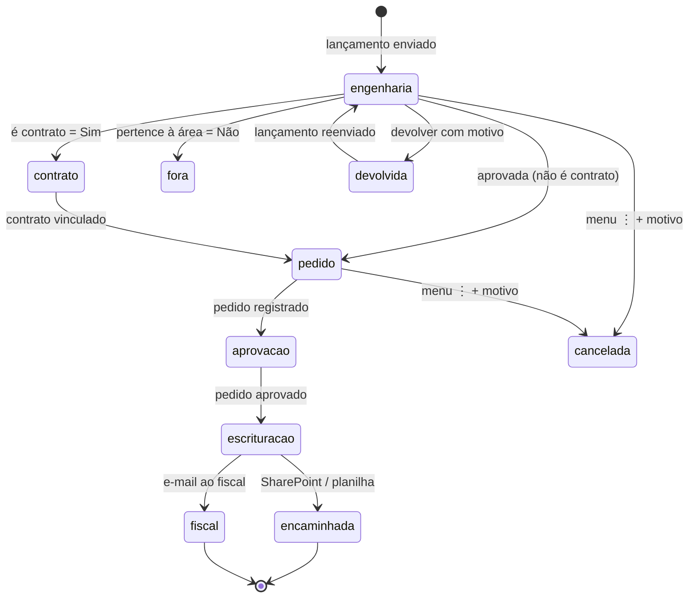

# 03 · O caminho de uma nota

Cada nota fica em **uma etapa por vez**. A etapa fica na coluna `etapa` da tabela `aprovacoes_notas`, e o banco só aceita os valores da lista (`aprovacoes_notas_etapa_check`). No painel, as etapas viram abas numeradas, cada uma com a contagem e o valor total das notas.

## As etapas

| # | Aba | Etapa no banco | Quem age | O que acontece |
|---|---|---|---|---|
| 01 | Expansão (na Engenharia: Engenharia) | `engenharia` | Engenheiro | Analisa a nota: narrativa, "é contrato?", "pertence à área?". Aprova, salva ou devolve |
| 02 | Contratos | `contrato` | Equipe, engenharia, administração | Vincula a nota a um contrato com saldo |
| 03 | A lançar | `pedido` | Equipe de lançamento | Registra o pedido no ERP e anota o número no painel |
| 04 | Aprovação do pedido | `aprovacao` | — (aguarda) | Espera a aprovação do pedido no ERP |
| 05 | Escrituração | `escrituracao` | Equipe de lançamento | "Enviar para escriturar", uma nota ou um lote |
| 06 | Fora da área | `fora` | — | Nota que não é da área ("Consultar destino") |
| 07 | Encaminhadas | `encaminhada`, `fiscal` | — | Já enviada: SharePoint (`encaminhada`) ou fiscal da unidade (`fiscal`). O retorno do robô entra aqui |
| 08 | Canceladas | `cancelada` | Equipe, administração | Cancelada pelo menu ⋮, sempre com motivo |
| 09 | Todas | — | — | Visão geral, com os mesmos filtros |

Etapas que não aparecem como aba:
- `devolvida`: a nota voltou ao lançamento para correção. Quando o lançamento é reenviado, ela volta para a análise;
- `arquivada`: histórico trazido do sistema antigo;
- `removida`: nota tirada do painel. Existe só na Expansão.



A regra de saída da análise está na função `aprovacoes_aprovar`:

```sql
novo := case when r.expansao = 'Não' then 'fora'
             when r.contrato = 'Sim' then 'contrato'
             else 'pedido' end;
```

## Perfis

O login fica no Supabase Auth. A **equipe** de cada pessoa fica na tabela `painel_perfis`, e o painel traduz a equipe do banco no perfil da tela:

| Equipe no banco | Perfil | O que vê e faz |
|---|---|---|
| `admin` | Administração | Tudo, nos dois painéis; cria contratos e dá acessos |
| `administrativo` | Equipe de lançamento | Lançamento, todas as abas de Aprovações e Contratos; corrige dados da nota e envia para escriturar |
| `expansao` | Engenharia | Análise, Contratos, Fora e Todas; na Expansão, também Projetos e Compras |
| `compras` | Compras (só Expansão) | Compras |
| `tag` | TAG (só Engenharia) | Só o painel da TAG |

**Primeiro acesso:**
- quem entra sem linha em `painel_perfis` escolhe a própria equipe, **uma única vez**;
- o banco limita essa escolha às equipes comuns (política `perfil_escolher`);
- `admin` e `tag` só são dados por um administrador.

## Regras combinadas com as equipes

- **Corrigir dados da nota:** só a equipe de lançamento e a administração, até a nota ser enviada. Toda correção vai para o histórico. Os dados bancários (banco, agência, conta, PIX) fazem parte da correção e seguem para a escrituração. Não é preciso redigitar.
- **Arquivos da nota:** dá para incluir e remover em qualquer etapa, também pelo visualizador de PDF. Remover não apaga: o arquivo sai do envio e pode ser **devolvido** à nota. O boleto que chega depois do envio pode ser incluído.
- **Mover de etapa e cancelar:** pelo menu ⋮ de cada linha. Cancelar exige motivo.
- **Vincular contrato:** equipe, engenharia e administração. Contrato sem saldo para o valor da nota não aparece na lista.
- **Reenvio para escriturar:** só para nota **recusada e corrigida**.
- **Reserva da nota:** quem abre a nota fica com ela ("Nota reservada para Fulano"), e os outros consultam em modo leitura. Quem fica com a nota é decidido pelo banco.
- **PDF:** abre sempre na mesma guia, reaproveitada a cada clique.
- **Cores:** Expansão em azul, Engenharia em laranja e TAG em verde. Formato, fonte e larguras são iguais entre os painéis.

## O que muda na Engenharia

O código é o mesmo. O gerador `copia-engenharia/montar-copia-engenharia.mjs` aplica as regras da área:
- **Pagador** de cada nota: Empresa Exemplo, Holding, TAG, Parceira, Coligada ou Condomínio. O pagador define o destino da escrituração ([05](05-escrituracao.md)).
- **Endereço da obra** e **categoria**, com listas fixas.
- Nota com **Pagador TAG** não vai para a escrituração: segue para o painel da TAG, onde é aprovada pelo aprovador do pagador ([10](10-modulos.md#painel-da-tag)).
- Aba **Atividades**, um quadro com cronograma, responsável e bonificação.

## Histórico: a trilha de cada nota

Cada função do banco acrescenta uma linha ao histórico da nota (`historico`, um array JSON). Alguns exemplos:

```
Análise aprovada · 18/11/2026 14:32 · Rafael
Contrato vinculado: CT-2026-014 · 18/11/2026 15:05 · Marina
Arquivo removido da nota: Boleto-1209.pdf · 19/11/2026 09:12 · Laura
Retorno da escrituração (automático · pedido 131629): APROVADA por … · 19/11/2026 10:40
```

O lançamento também tem auditoria própria. O gatilho `trg_audit_lancamento` registra mudança de status em `historico_status`, e as exclusões deixam marca em `exclusoes_recentes`. Por isso, uma nota apagada não volta sozinha quando o arquivo continua na pasta.
