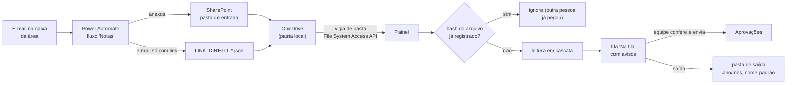

# 04 · Entrada e leitura das notas

Do e-mail do fornecedor até uma linha conferida na fila do painel.

## 1. Chegada

- O fluxo **"Notas"** do Power Automate (um por área) vigia a caixa de e-mail e salva cada anexo na pasta de entrada do SharePoint.
- Quando o e-mail traz um **link** em vez do PDF, o fluxo grava um arquivo `LINK_DIRETO_*.json` com o link.
- O OneDrive sincroniza a pasta no computador da equipe.
- O painel lê a pasta pelo navegador, com a **File System Access API**, que só existe no Chrome e no Edge. É a "vigia de pasta", que verifica de tempos em tempos se há arquivo novo.

**Por que pela pasta, e não pelo servidor:** a pasta já existia e era o que a equipe usava. A leitura no navegador não precisa de servidor com acesso ao SharePoint, e a equipe vê na hora o que entrou.

## 2. Uma nota, uma linha, mesmo com várias pessoas vigiando

Toda a equipe deixa o painel aberto vigiando a mesma pasta. A primeira versão perguntava "esse arquivo já existe?", lia a nota, o que leva alguns segundos, e salvava. Duas pessoas ouviam "não existe" ao mesmo tempo e criavam **duas linhas**.

A correção inverteu a ordem. Antes de ler qualquer coisa, o painel calcula o **hash SHA-256** do arquivo (`crypto.subtle.digest`) e tenta registrá-lo em `arquivos_processados`, numa coluna que não aceita repetição. Só quem consegue registrar segue em frente. **Quem decide a corrida é o banco.**

Outro cuidado: **nota excluída que voltava.** Quando alguém excluía uma nota, o arquivo continuava na pasta e a nota era criada de novo segundos depois. Agora a exclusão deixa uma marca no banco (`exclusoes_recentes`) antes de apagar o registro, e o painel ignora aquele arquivo.

## 3. Leitura em cascata

| Ordem | Fonte | Quando |
|---|---|---|
| 1 | **XML** da NF-e/CT-e (`DOMParser`) | Quando o fornecedor manda o XML. É a fonte mais confiável |
| 2 | **Texto do PDF** (PDF.js) | PDF com texto, lido por padrões (número, CNPJ, valores, datas e linha digitável) |
| 3 | **IA** (função `ler-documento`, Gemini Flash pelo OpenRouter) | Desde outubro de 2026, é o leitor principal dos PDFs |
| 4 | **OCR** (Tesseract) | Reserva, para PDF de imagem quando a IA não responde |

O que cada leitor trouxe fica guardado **separado** do que a equipe corrigiu (`extracao_original`). Isso permite medir quanto cada leitor acerta.

### A chamada à IA

- O painel manda o PDF em base64 para a função `ler-documento`. A chave da IA nunca sai do servidor, e só quem está logado chama a função (`verify_jwt = true`).
- A resposta segue um **JSON Schema**:
  - tipo de documento, natureza e forma de pagamento só aceitam valores da lista;
  - o que não existe no documento volta vazio;
  - há uma lista à parte com os campos de que o modelo **não tem certeza**.
- O prompt descreve as armadilhas reais:
  - a empresa compradora nunca é o fornecedor;
  - o número da nota não é a chave de acesso nem o RPS;
  - em nota de serviço vale o valor **bruto**.
- O OpenRouter recebe um **modelo de reserva**. Erros passageiros são repetidos, e `data_collection: "deny"` restringe a provedores que não guardam nem treinam com os documentos.

### Conferir o que a IA leu

A IA erra com confiança, então o painel confere:
- se o **dígito verificador do CNPJ** bate;
- se o **número** e o **valor** lidos aparecem mesmo no texto do PDF;
- se o valor bate com a **linha digitável do boleto** (padrão FEBRABAN), a fonte mais confiável;
- quais campos o próprio modelo marcou como incertos;
- se o arquivo foi reconhecido como nota ou boleto.

Qualquer problema vira um aviso na linha ("conferir", com o motivo). A meta é que uma nota sem aviso possa ser lançada sem abrir o PDF.

## 4. Unidade pelo CNPJ de quem comprou

Cada filial do grupo tem um CNPJ. A unidade da nota sai do **CNPJ do tomador**, por votação:
- uma tabela verificada de CNPJ para unidade conta como voto;
- cada nota antiga cuja unidade foi **confirmada por uma pessoa** (`unidade_confirmada`) também vota.

O campo só é preenchido quando os votos são **unânimes**. Com um voto contrário, fica vazio, porque unidade errada é pior que vazia: vazia, a pessoa preenche; errada, passa sem ninguém perceber.

## 5. Boletos

- **Boleto e nota se encontram** pelo número da nota e pelo emissor. O emissor é o mesmo quando o CNPJ é igual ou quando são **matriz e filial**, com a mesma raiz de 8 dígitos e o nome parecido. Um fornecedor emitia a nota por uma filial e o boleto pela matriz.
- **Boleto conjunto:** um boleto pode pagar várias notas, como 15 notas e um único boleto com o total. Ele vira arquivo de todas elas, e a confirmação fica com uma pessoa.
- **Boleto = valor líquido da nota** (imposto retido) é o caso normal. A diferença é registrada e não vira alerta.
- **Boleto que chega depois do envio** pode ser incluído na nota já enviada.

## 6. Nota por link

| Tipo de link | Como é resolvido |
|---|---|
| Link que entrega o PDF direto | A função `baixar-link-direto` baixa no servidor, sem o bloqueio de CORS do navegador, e guarda no Storage |
| Página de prefeitura sem código | A função `baixar-nota-link` baixa e devolve o PDF. Ela só aceita o arquivo se ele começar com `%PDF` |
| Prefeitura que bloqueia a nuvem | Um portal municipal derrubava conexões vindas da AWS, onde a função roda. Um **Worker na Cloudflare** busca a página e devolve o PDF (`codigo/paineis-originais/Expansão/painel/cloudflare-baixador/`) |
| Link de verificação com código e reCAPTCHA | Não é automatizado: a linha fica com o botão "Abrir nota" |

## 7. Medir antes de automatizar: o "modo sombra"

Antes de ligar o **envio automático** das linhas que passam em todas as conferências, o painel passou cerca de três semanas em **modo sombra**, de 7 a 29 de outubro de 2026:
- quando uma linha ficava pronta **sozinha**, sem nenhuma edição humana, o painel gravava uma "foto" dela em `sombra_envio`;
- depois que a equipe enviava, a foto era comparada com o que a pessoa realmente enviou.

A pergunta que essa comparação respondia era: "o automático teria acertado?". A foto guarda os campos que importam: NF, fornecedor, CNPJ, unidade, valor, datas, natureza, pagamento, dados bancários e arquivos.

Com a medição, o envio automático das linhas prontas foi ligado (build141). Em novembro ele foi desligado de propósito (build147), quando a aprovação passou para o fluxo próprio.

## 8. Saída

Quando a nota é enviada, o arquivo é **renomeado** com um padrão (NF, fornecedor e unidade) e guardado na **pasta de saída**, separada por ano e mês. A pasta de entrada fica só com o que ainda não foi tratado.
