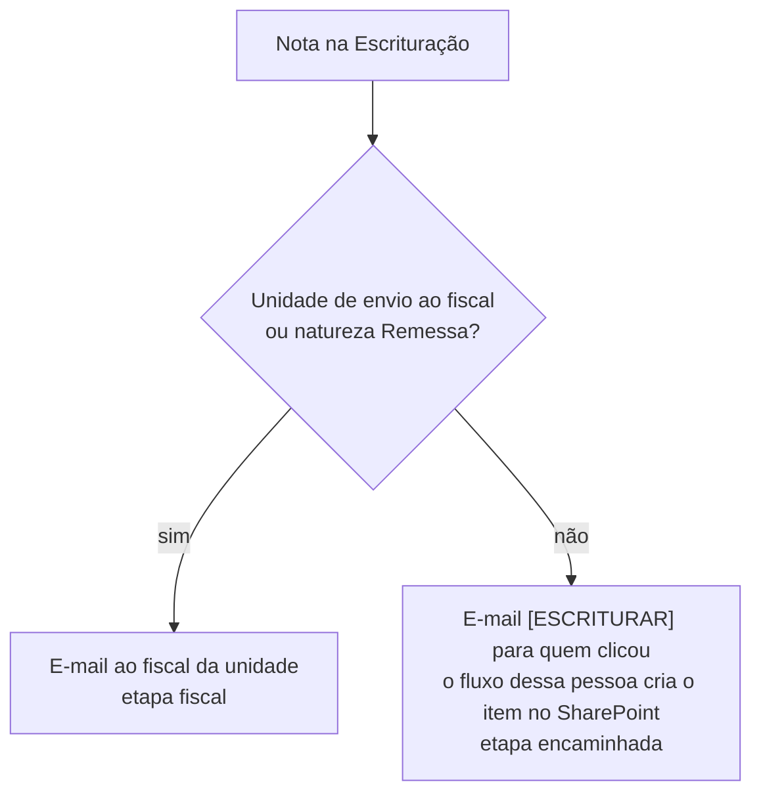
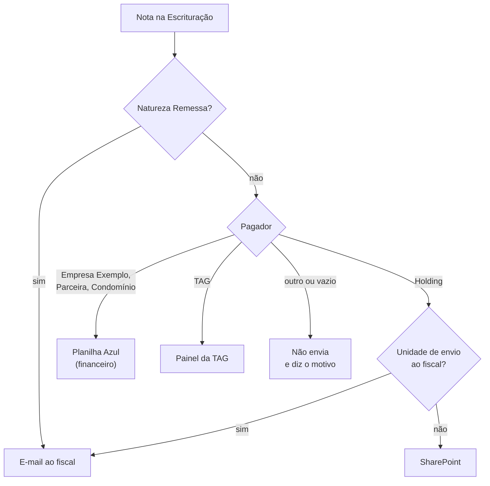
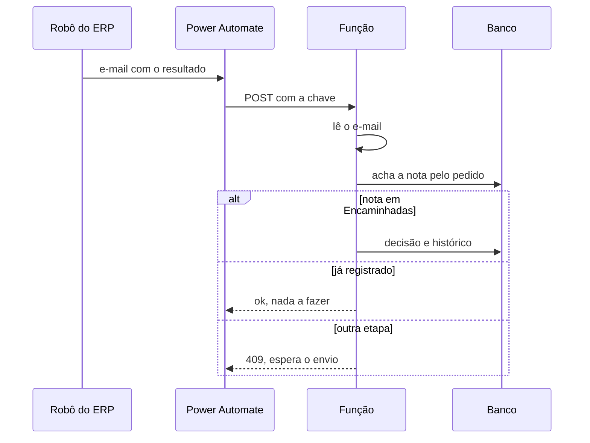

# 05 · Escrituração

O botão **"Enviar para escriturar"** chama a função `escriturar-painel`. Ele funciona para uma nota ou para um lote: em "Ver tudo e enviar para escriturar", o "−" tira uma nota do lote.

A função monta a nota a partir do banco:
- usa o lançamento, mais as **correções feitas no painel**, que valem sobre tudo;
- acha o **código do emitente** no cadastro de fornecedores do ERP, copiado para o banco (`datasul_fornecedores`), pelo CNPJ;
- converte unidade, natureza e forma de pagamento para os valores da lista da escrituração;
- junta os **anexos sem repetição**: a nota, todos os boletos vinculados e os arquivos incluídos depois. Os arquivos que alguém **removeu da nota** no painel não vão.

Depois, ela envia por um de três caminhos.

## Para onde vai cada nota

**Expansão**



**Engenharia**



| Área | Caso | Destino |
|---|---|---|
| Expansão | Unidade de envio ao fiscal (na demonstração, "Pinhal") ou natureza **Remessa** | E-mail ao fiscal da unidade (tabela `fiscais_unidade`, 21 unidades). Etapa `fiscal` |
| Expansão | Demais | SharePoint, pelo caminho abaixo. Etapa `encaminhada` |
| Engenharia | Natureza **Remessa**, qualquer pagador | E-mail ao fiscal |
| Engenharia | Pagador **Holding**, unidade de envio ao fiscal | E-mail ao fiscal |
| Engenharia | Pagador **Holding**, demais unidades | SharePoint |
| Engenharia | Pagador **Empresa Exemplo**, **Parceira** ou **Condomínio** | E-mail "Planilha Azul" para os destinatários do financeiro |
| Engenharia | Pagador **TAG** | Não vai para a escrituração: segue para o [painel da TAG](10-modulos.md#painel-da-tag) |
| Engenharia | Outro pagador ou sem pagador | Não envia. O painel avisa o motivo |

### O caminho do SharePoint

1. A função manda, pela **caixa da escrituração** (Microsoft Graph), um e-mail `[ESCRITURAR] …` para a **caixa de quem clicou**.
2. Na conta dessa pessoa, o fluxo **"Escrituração Automática"** do Power Automate vê o e-mail e cria o item da escrituração na lista do SharePoint, com os anexos.

**Por que pela caixa de quem clicou:** o item precisa ser criado em nome de quem enviou. O fluxo roda na conta de cada pessoa, que precisa ter o fluxo ligado e vigiando a pasta certa.

## Regras do envio

- **Real ou prévia:** o segredo `ESCRITURACAO_EMAIL_MODO` decide. Na prévia, **todos** os e-mails vão para o endereço de teste (`REVIEW_EMAIL`), com a tabela montada para conferência.
- **Reenvio:** só para nota **recusada e corrigida**. Fora disso, o botão não reenvia.
- **Histórico:** cada envio vira uma linha no histórico da nota, com o destino.

## O retorno: pedido aprovado ou recusado

Depois da escrituração, o ERP aprova ou rejeita o pedido. A resposta chega por e-mail, de um robô ("RPA"), num texto fixo:

```
Seu pedido 131629, foi Aprovado por <quem> e seguirá para Escrituração!! ... Motivo: ...
Seu pedido 131426, foi Rejeitado por <quem> e não seguirá para Escrituração! ... Motivo: ...
```



A função é a `retorno-escrituracao`, e a nota fica em `aprovacoes_notas`. Ela lê no e-mail o pedido, o resultado, quem decidiu e o motivo.

- **Autenticação por chave:** o fluxo manda o segredo `RETORNO_CHAVE` no cabeçalho `x-chave-retorno`. A função não usa login, porque quem chama é um fluxo, e não uma pessoa (`verify_jwt = false`).
- **Idempotente:** se o mesmo e-mail chegar duas vezes, o segundo não duplica o histórico.
- **Plano B:** sem o fluxo ligado, a equipe registra o retorno pela própria janela da nota.
- A recusa volta para a equipe, que corrige a nota e faz o **reenvio**.

## Código

- `codigo/funcoes/expansao/supabase/functions/escriturar-painel/index.ts`
- `codigo/funcoes/engenharia-e-tag/supabase/functions/escriturar-painel/index.ts`: regras por pagador
- `codigo/funcoes/*/supabase/functions/retorno-escrituracao/index.ts`
