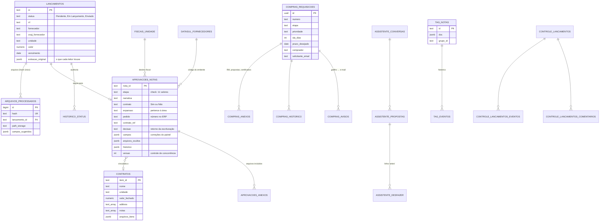

# 06 · Banco de dados

Dois projetos Supabase (Postgres):

| Banco | Tabelas | Políticas RLS | Funções SQL | Gatilhos | O que guarda |
|---|---|---|---|---|---|
| **Expansão** | 48 | 104 | 62 | 14 | Lançamento, aprovações, contratos, compras, projetos, atividades, Controle de Lançamentos, cadastros do ERP, assistente |
| **Engenharia + TAG** | 30 | 63 | 41 | 15 | Lançamento e aprovações da Engenharia; painel da TAG (`tag_*`); assistente |

**Todas as 78 tabelas têm RLS ligado.** A estrutura completa, sem dados, está em [`codigo/banco/`](../codigo/banco/):
- os arquivos `esquema-*.sql` têm tabelas, políticas, funções e gatilhos;
- os arquivos `tabelas-*.md` têm o resumo.

## Modelo (núcleo)



> As colunas mostradas são as principais. Os nomes `monday_*` que aparecem em algumas tabelas são da migração: guardam a referência do item no sistema antigo, como histórico.

## Padrões usados

### Regras em funções `SECURITY DEFINER`

O painel **não grava direto** nas tabelas de aprovação, contratos e compras. Cada ação é uma função chamada por RPC: `aprovacoes_aprovar`, `aprovacoes_devolver`, `aprovacoes_mover`, `aprovacoes_vincular_contrato`, `aprovacoes_registrar_pedido`, `aprovacoes_registrar_retorno`, `aprovacoes_editar_campos`, `compras_criar`, `compras_mover`, `contratos_criar`, `contratos_criar_aditivo` e outras.

O roteiro de cada uma está em [02 · Arquitetura](02-arquitetura.md#1-regra-de-negócio-no-banco-não-na-tela): identidade, perfil, etapa, campos obrigatórios, versão e histórico.

### Concorrência otimista

`aprovacoes_notas.versao` aumenta a cada mudança. O painel manda a versão que está vendo (`p_base`). Se outra pessoa já alterou a nota, a função recusa:

```sql
if p_base is not null and r.versao <> p_base then
  raise exception 'Esta nota foi alterada por outra pessoa. Atualize a tela e tente de novo.';
end if;
```

### Perfis e primeiro acesso

- `painel_perfis` (`email`, `equipe`) diz a equipe de cada login.
- A política `perfil_escolher` deixa a pessoa **escolher a própria equipe uma única vez**, e só entre as equipes comuns. `admin` e `tag` só são dados por SQL.
- As funções `painel_equipe()` e `compras_eu()` devolvem a equipe e o nome de quem chama, a partir do token.

### Listas de acesso no banco

| O quê | Onde |
|---|---|
| Quem vê Projetos e Portfólio, e quem edita o Portfólio | `painel_projetos_pode`, `painel_portfolio_pode`, `painel_portfolio_edita` e a tabela `projetos_acesso` |
| Quem usa o Controle de Lançamentos | Função `controle_autorizado` |
| Quem cria contrato | `contratos_pode_criar` (só administração) |

### Gatilhos

| Gatilho | Tabela | O que faz |
|---|---|---|
| `aprovacoes_completar` | `aprovacoes_notas` | Completa a análise com os dados do histórico, para notas que vieram do sistema antigo |
| `trg_audit_lancamento` | `lancamentos` | Registra mudança de status em `historico_status` |
| `trg_assistente_desfazer` | `lancamentos`, `arquivos_processados`, `historico_status`, `exclusoes_recentes` | Guarda a linha "antes" das mudanças confirmadas pelo assistente, para o **Desfazer** |
| `compras_avisos_disparo` | `compras_avisos` | Chama a função `avisar-compras` por HTTP (`pg_net`), autenticada com uma chave guardada no **Vault** |
| `compras_nao_recriar`, `contratos_nao_recriar` | `compras_requisicoes`, `contratos` | Impedem que um registro excluído volte pela cópia do sistema antigo |
| `controle_*` | `controle_lancamentos`, `controle_lancamentos_comentarios` | Histórico, comentários e exclusão registrada no Controle de Lançamentos |
| `tag_*_avisa` | tabelas `tag_*` | Avisam o painel da TAG por tempo real quando algo muda |

### Cofre (Vault)

As chaves que o próprio banco usa para chamar funções (o gatilho de Compras, por exemplo) ficam no **Vault** do Supabase, e não no código. As chaves das funções ficam nos **secrets** das Edge Functions. Os nomes estão em [07](07-funcoes.md#segredos).

### Papéis do assistente

Dois papéis do Postgres, com permissões explícitas (`GRANT`):
- `assistente_leitura` só faz `SELECT`, com tempo e número de linhas limitados;
- `assistente_escrita` só altera as tabelas permitidas e só é usado depois que a pessoa confirma.

Detalhes em [09](09-assistente-com-ia.md).

## Armazenamento de arquivos (Storage)

| Bucket | O que guarda |
|---|---|
| `documentos` | PDFs e XMLs das notas e boletos |
| `contratos` | Anexos dos contratos e aditivos |
| `compras` | RM, propostas e certificados de qualidade |
| `tag-arquivos` | Notas e comprovantes da TAG |
| `monday-arquivos` | Arquivos copiados do sistema antigo (histórico) |

O acesso aos arquivos segue a mesma regra das notas. A função `arquivo-monday`, por exemplo, só entrega um arquivo se ele estiver na lista de uma nota ou de um contrato que a pessoa pode ver, e quem confere isso é o próprio banco, com o login de quem pediu.
