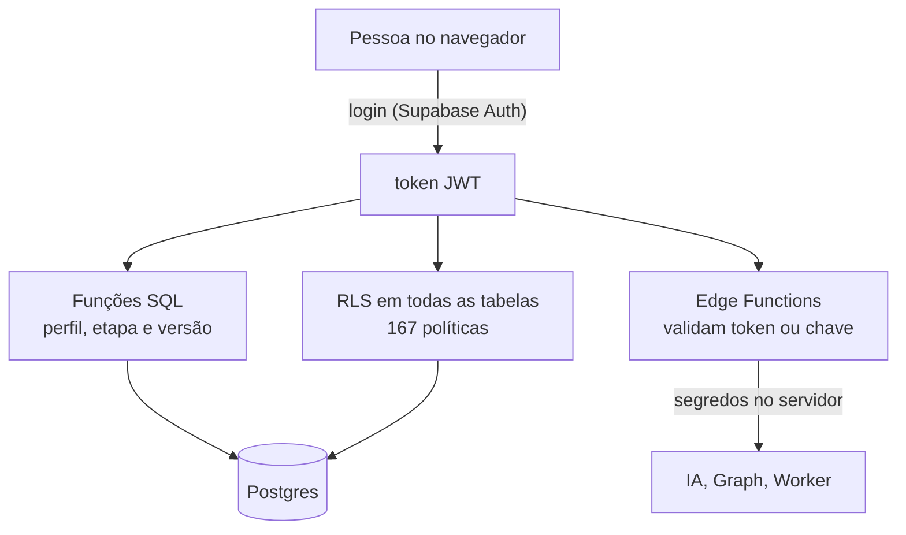

# 08 · Segurança e privacidade

## Camadas de proteção

1. **Login:** Supabase Auth, com contas criadas pela administração ou por convite. A recuperação de senha é própria: o e-mail sai pela caixa da empresa, com limite de pedidos e resposta que não revela se o e-mail tem conta.
2. **Equipe e perfil no banco:** `painel_perfis`. A pessoa escolhe a própria equipe **uma vez** e só entre as equipes comuns. Administração e TAG só são dadas por SQL.
3. **RLS em todas as 78 tabelas:** a regra de quem lê e quem grava está no banco. A chave pública que vai no site não dá acesso a nada sozinha.
4. **Ações pelas funções do banco:** aprovar, devolver, mover, vincular contrato e corrigir campos só acontecem por funções que conferem perfil, etapa, campos obrigatórios e versão ([06](06-banco-de-dados.md#regras-em-funções-security-definer)).
5. **Funções do servidor:** cada uma confere quem chama, seja pelo login, pelo token validado na própria função ou por uma chave no cabeçalho (fluxos e gatilhos). Ver [07](07-funcoes.md).
6. **Segredos fora do código:** chaves de IA, do Graph e do Worker ficam nos secrets das funções. As chaves usadas pelo próprio banco ficam no **Vault**. O site só tem a chave **pública**.
7. **Arquivos:** o acesso a um PDF segue a permissão da nota ou do contrato a que ele pertence, conferida pelo banco com o login de quem pediu.
8. **Histórico:** cada ação grava quem fez e quando. A auditoria de status do lançamento é feita por gatilho, e não pela tela.

## IA com dados da empresa

- **Leitura dos documentos:** a chamada passa pelo servidor e usa `data_collection: "deny"`, que restringe a provedores que **não guardam nem treinam** com os documentos.
- **Assistente:**
  - lê com um papel do Postgres que só faz `SELECT`;
  - escreve só depois da confirmação de uma pessoa, com outro papel, que só altera tabelas permitidas, e com desfazer;
  - usa uma chave própria, com **limite de gasto**.

  Detalhes em [09](09-assistente-com-ia.md).

## Demonstração isolada

A demonstração usa o mesmo código da produção, com três travas para não tocar em nada real:

1. **Política de segurança de conteúdo (CSP)** no HTML: `default-src 'none'; connect-src 'none'; form-action 'none'`. O navegador não deixa a página abrir nenhuma conexão de rede, além das bibliotecas e fontes de CDN.
2. **Banco falso** na memória da página (`demo-banco.js`), com dados fictícios. Os endereços do Supabase são trocados por `http://demonstracao.invalid`.
3. **Trava na montagem:** o gerador para com erro se o HTML final citar o banco real (`.supabase.co`, `functions/v1`, chave publicável) ou um endereço de produção.

## Saída do desenvolvedor

Quando saí do projeto, entreguei ao responsável seguinte um pacote com o código, a documentação e a **lista do que precisava ser trocado**:
- recriar os fluxos do Power Automate que estavam na minha conta;
- trocar as chaves que eu conhecia (IA, Graph, retorno do robô, senha do banco, papéis do assistente);
- revogar o meu token de publicação;
- me tirar das listas de acesso.

Nenhum valor de chave foi para o pacote. Os documentos só citam os **nomes** dos segredos.

## O que foi anonimizado neste repositório

O código publicado é o código de produção, passado por um script de limpeza que troca, **de forma consistente em todos os arquivos**:

| Original | Neste repositório |
|---|---|
| Nome da empresa e do grupo, logotipos | "Empresa Exemplo", "Holding" e uma marca neutra desenhada para cá |
| Pessoas (nomes e e-mails) | Nomes fictícios (`@empresa.exemplo`, `@holding.exemplo`) |
| 21 unidades (cidades) e endereços de obras | Outras cidades e endereços genéricos ("Rua das Acácias, 100 - Centro") |
| CNPJs da empresa e de fornecedores citados | CNPJs fictícios, com dígito verificador recalculado |
| Fornecedores citados em comentários de casos reais | "Fornecedora A", "Fornecedora B" e assim por diante |
| Pagadores externos | "TAG", "Parceira", "Coligada", "Condomínio Lago" |
| Projetos Supabase, sites e IDs de publicação | `seu-projeto-expansao`, `seu-site.netlify.app`, zeros |
| Chaves públicas | `sb_publishable_SUA_CHAVE_PUBLICA` |
| Dados de quadros (atividades, notas da TAG) | Gerados do zero, fictícios |

Depois da troca, conferi:
- **padrões:** e-mails, CNPJs, CPFs, telefones, chaves (`sb_publishable_`, `sb_secret_`, JWT), endereços `*.supabase.co`, `*.netlify.app` e `*.sharepoint.com`, e GUIDs;
- **nomes próprios:** todas as palavras com inicial maiúscula que nunca aparecem em minúscula no código, revisadas uma a uma;
- **imagens embutidas:** logotipos trocados;
- **funcionamento:** os geradores continuam montando os painéis (os trechos exatos continuam batendo), os 48 testes passam e a demonstração abre sem erro.
