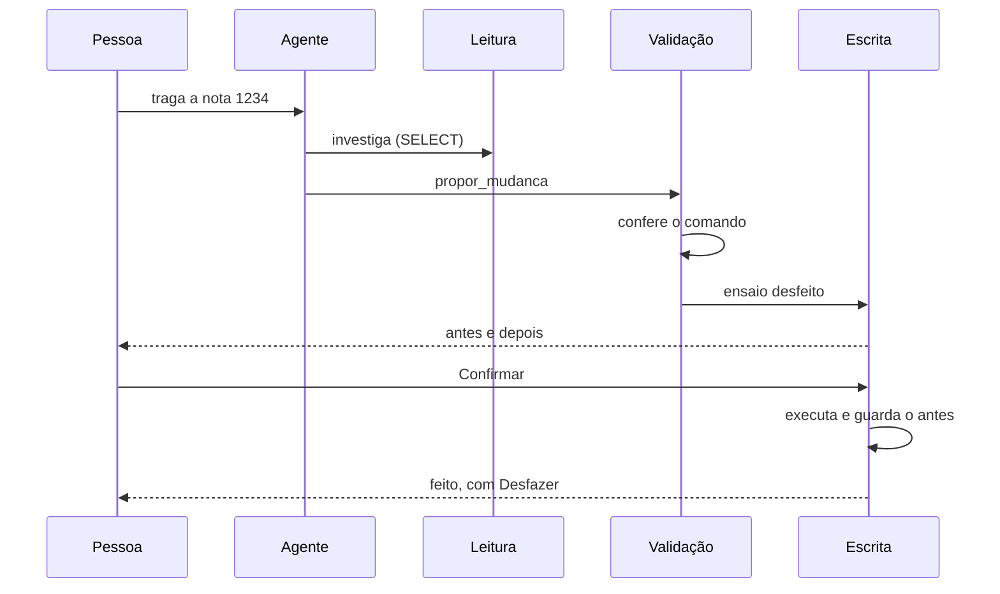

# 09 · Assistente com IA

Toda dúvida sobre uma nota acabava chegando em mim: "o que aconteceu com a nota 1234?", "quem excluiu?", "já foi enviada?". Para responder, eu abria o banco e montava a história. Então coloquei o **Claude** dentro do painel para fazer essa investigação.

A pessoa pergunta em português e recebe a resposta em português simples, dizendo **de onde** tirou cada informação.

## Como funciona

É um agente com ferramentas, rodando na Edge Function `assistente` ([código](../codigo/funcoes/expansao/supabase/functions/assistente/)). O modelo é chamado pelo OpenRouter e pode ser trocado por configuração (`ASSISTENTE_MODEL`). A temperatura é 0, e as instruções fixas ficam em cache.

Para cada pergunta, o agente dá até **10 passos**, com três ferramentas:

| Ferramenta | O que faz |
|---|---|
| `rastrear_nota` | Monta a linha do tempo de uma nota: quando chegou, quem mexeu, se foi excluída, em que etapa está |
| `consultar_banco` | Consulta livre, **só de leitura**, com limite de tempo e de linhas |
| `propor_mudanca` | Prepara uma correção para uma pessoa aprovar. **Não executa nada** |

As instruções (`manual.ts`) mandam o agente investigar antes de responder e citar a fonte. "Não encontrei" é uma resposta aceitável; resposta inventada, não.

## As travas estão no banco, não no prompt

"Leitura" e "Escrita" são os papéis `assistente_leitura` e `assistente_escrita` do Postgres. A validação confere se é um comando só, numa tabela permitida e sem palavra proibida. A proposta vale por 15 minutos.

1. **Leitura:** as consultas rodam com o papel `assistente_leitura`, que só tem `SELECT`. Mesmo que o código erre, o papel não deixa passar disso.
2. **Proposta:** `regras.ts` recusa cedo, com motivo legível:
   - mais de um comando por proposta;
   - tabela ou operação fora da lista;
   - palavras proibidas, como `drop`, `alter`, `grant`, `copy`, `execute`, `set_config` e `pg_sleep`;
   - *dollar-quoting*.

   A validação lê um "esqueleto" do SQL, sem textos e comentários, para não ser enganada por um `;` dentro de uma string.
3. **Tabelas que podem ser alteradas:**

   | Tabela | Operações |
   |---|---|
   | `lancamentos` | `INSERT`, `UPDATE` |
   | `arquivos_processados` | `INSERT`, `UPDATE` |
   | `exclusoes_recentes` | `DELETE` (trazer de volta uma nota excluída) |
   | `historico_status` | `INSERT` |

4. **Ensaio:** a mudança roda numa transação que é **desfeita** no final. A pessoa vê o antes e o depois.
5. **Confirmação:** só quando a pessoa clica em Confirmar a mudança acontece de verdade, com o papel `assistente_escrita`, cujos `GRANT`s são a trava real.
6. **Desfazer:** o gatilho `trg_assistente_desfazer` guarda como a linha estava (`assistente_desfazer`).
7. **Validade:** a proposta expira em 15 minutos e não roda duas vezes se alguém clicar duas vezes.

## Problemas reais

- **"Os números mudaram, desculpe o erro."** Alguém perguntava "o que entrou nos últimos 20 minutos?" duas vezes, em horários diferentes. Os números mudavam, e o modelo pedia desculpas por um erro que não existia. Resolvi guardando, junto com cada resposta, a **hora** e as consultas feitas, para ele saber que eram períodos diferentes.
- **Custo:** o assistente usa uma chave separada da leitura de notas, com limite de gasto. Cada conversa fica registrada em `assistente_conversas`, com custo, passos e propostas.
