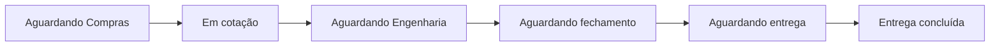

# 10 · Módulos

Além do caminho das notas, o sistema tem módulos para o que acontece em volta delas.

## Contratos

- **Tabela** `contratos` nos dois bancos; anexos no bucket `contratos`.
- **Aditivos** e medições como subitens, com os arquivos de cada um, na ordem do contrato.
- **Saldo:** valor fechado menos as notas já vinculadas. Na hora de vincular, **contrato sem saldo para a nota não aparece na lista**.
- **Quem faz o quê:**
  - criar contrato e aditivo: só a administração (`contratos_pode_criar`);
  - editar: perfis autorizados (`contratos_pode_editar`);
  - excluir: só a administração;
  - vincular nota: equipe, engenharia e administração.
- **Por que no sistema:** a etapa "Contratos" das aprovações precisa saber o saldo na hora, e o vínculo fica no histórico da nota.

## Compras (Expansão)

Requisições de material e serviço, da solicitação à entrega.

Na etapa da engenharia, a proposta pode ser aprovada, receber pedido de ajuste ou ser recusada com motivo. A recusa leva a requisição para o grupo "Recusada".

- **Requisição (RM)** com três grupos de anexo: RM, **propostas** e **certificados de qualidade**. Os arquivos ficam no bucket `compras`.
- **Prazos:** o SLA conta em dias corridos desde a criação da RM, com selo de prioridade.
- **Indicadores do procedimento de Compras**, calculados no painel, cada um com a meta escrita ao lado:
  - prazo médio de cotação;
  - mínimo de 3 cotações por requisição;
  - prazo médio de aprovação;
  - confirmação do pedido em até 24 h;
  - cumprimento do prazo de entrega;
  - não conformidades.
- **Quem decide:** a engenharia aprova a proposta ou pede ajuste. Quem decide é o solicitante ou a engenharia autorizada (`podeDecidirReq`, coberto pelos testes).
- **E-mails automáticos:** na abertura, aprovação, ajuste e recusa. Um **gatilho do banco** (`compras_avisos_disparo`) chama a função `avisar-compras` pelo `pg_net`, com chave do Vault.
  - O e-mail vai **com os documentos** da requisição.
  - Leva o nome de quem agiu e "responder para" essa pessoa.
  - O destino fica em `compras_config`.
- **Visões:** cartões ou tabela, filtros por unidade, situação e prioridade, e exportação para Excel.

## Projetos, Portfólio e Atividades

- **Projetos (Expansão):** quadro por grupos ("em execução", "em estudo", "pós-obra"), com unidade, status, duração e custo planejados e reais, e subitens. Dá para criar e editar no próprio painel e exportar para planilha. Quem vê e quem edita é decidido pelo banco (`painel_projetos_pode`).
- **Portfólio:** página com os indicadores do portfólio de projetos, lida pelas regras de acesso do banco (`painel_portfolio_pode`, `painel_portfolio_edita`).
- **Atividades (Engenharia):** quadro de obras, facilities e licenciamento, com local, responsável, cronograma planejado e real, custo e **bonificação**. A equipe toda vê e exporta, e a administração cria e edita.

## Painel da TAG

As notas de um **pagador externo** (chamado aqui de TAG) têm um painel próprio, com regras e aprovador próprios.

- **De onde vêm as notas:**
  - lançamento no próprio painel, pelo formulário com as mesmas condições do processo antigo;
  - notas da **Engenharia com Pagador TAG**, que chegam por uma função do banco (`tag_receber_nota`).
- **Abas por empresa e situação:**
  - Holding e Empresa Exemplo: pendentes, aprovadas e enviadas;
  - TAG: pendentes, aprovadas, aguardando comprovante, pagas e reprovadas;
  - Outros.
- **Automações**, copiadas do processo antigo com o mesmo comportamento:

  | Gatilho | Ação |
  |---|---|
  | Nota criada | Nome "NF - fornecedor" e pagador TAG |
  | Aprovação do aprovador da TAG = Aprovado | Move para "TAG - aprovadas" |
  | Status = Em andamento | Move para "aguardando comprovante" |
  | Comprovante incluído | Status = Pago e move para "pagas" |
  | Aprovação = Reprovado | E-mail e move para "reprovadas" (vem **desligada**, como era) |

  Mover a nota de grupo **à mão** não dispara automação, igual a arrastar no quadro antigo.
- **Quem edita:**
  - dois logins: o aprovador e o back-office do pagador, e só depois de **trocar a senha inicial** no primeiro acesso;
  - os outros logins com equipe só leem;
  - depois de "Aprovado", a decisão fica **travada** para o pessoal da TAG, e só a administração destrava.
- **Arquivos:** prévia do PDF ao lado dos campos, **download em ZIP** de um grupo inteiro e lista do que ficou de fora.
- **Servidor:** a função `tag-api` é a API REST, com rotas `/api/*` e `/files/*`. Os dados ficam no banco da Engenharia (`tag_notas`, `tag_eventos`, `tag_automacoes`, `tag_outbox`, `tag_meta`) e os arquivos no bucket `tag-arquivos`. Antes de ir para o Supabase, a mesma API rodava num `server.mjs` local, com os mesmos testes.
- **Testes:** 33, cobrindo automações, permissões, primeiro acesso e armazenamento (`codigo/tag/notas-fiscais/tests/`).

## Controle de Lançamentos

Uma aba dentro do painel da TAG para a equipe de lançamento controlar o próprio trabalho.

- Lançamentos por fornecedor, com **comentários** e **histórico** de cada mudança. Os gatilhos registram quem fez, inclusive as exclusões.
- **Login:** aceita o da Expansão **ou** o da TAG (Engenharia). A função `controle-api` valida o token e confere o e-mail na lista `controle_autorizado`.
- **Dados:** banco da Expansão (`controle_lancamentos`, `_eventos`, `_comentarios`, `controle_fornecedores`).
- **Código da tela:** `codigo/site/producao/controle/`.
