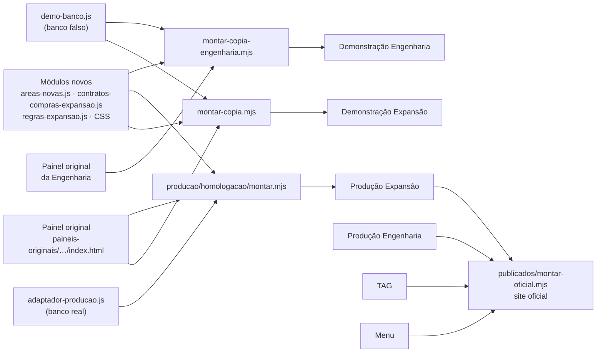

# 11 · Build, testes e publicação

## O problema

O painel de lançamento é uma página única de cerca de **16 mil linhas**, em produção desde julho de 2026, com 147 versões publicadas. Em novembro, ele precisava ganhar Aprovações, Contratos, Compras e Projetos, uma versão de demonstração e uma versão da Engenharia. E nada disso podia atrapalhar quem usava o painel todos os dias.

Reescrever levaria semanas. Copiar e colar código criaria três versões divergentes.

## A solução: geradores com trechos exatos

O painel original continua sendo a fonte. Os **geradores** (scripts Node, sem dependências) leem o original e montam cada painel final:



Cada gerador faz as mudanças com funções que **exigem achar o trecho exatamente uma vez**:

```js
function trocar(de, para){
  const n = html.split(de).length - 1;
  if (n !== 1) throw Error(`Esperava 1x, achei ${n}x: ${de.slice(0, 80)}`);
  html = html.split(de).join(para);
}
```

Se alguém mudar o painel original e um trecho deixar de existir, ou passar a aparecer duas vezes, a montagem **para com erro**. Isso evita gerar um painel quebrado em silêncio.

Os módulos de mudança ficam em arquivos pequenos e nomeados:
- `entrada-padrao.mjs`: login igual nos três painéis;
- `inclusao-manual.mjs`;
- `boleto-depois-do-envio.mjs`;
- `aba-unica-documentos.mjs`;
- `sem-monday.mjs`: tira das telas o nome do sistema antigo.

Cada módulo é aplicado pelos geradores que precisam dele.

### Travas de cada montagem

| Montagem | Trava |
|---|---|
| Demonstração | CSP `connect-src 'none'`. Para com erro se o HTML citar o banco real (`.supabase.co`, `functions/v1`, chave publicável). `localStorage` vira `sessionStorage`, para não misturar com o painel real aberto no mesmo navegador |
| Produção | Para com erro se o código levar controles da demonstração ("Ver como", banco falso) |
| As duas | Nenhum módulo injetado pode conter `</script` |
| Site oficial | Para se sobrar endereço antigo da TAG no HTML da Engenharia. Os tokens de cor e fonte da TAG são extraídos do painel da Expansão a cada montagem, para manter o mesmo visual |

## Publicação

**Produção (Netlify):** `node codigo/site/publicados/montar-oficial.mjs --publicar` gera os painéis e junta tudo em um site:

```
/              portal de equipes
/expansao/     painel da Expansão (+ /expansao/portfolio/)
/engenharia/   painel da Engenharia
/tag/          painel da TAG + Controle de Lançamentos
_redirects     /api/* e /files/* → função tag-api (Supabase)
```

Antes de cada mudança grande, criei pontos de retorno:
- backup dos bancos;
- cópia das páginas no ar;
- o ID da versão publicada no Netlify, que permite voltar com um clique.

**Demonstração (GitHub Pages):** `node codigo/montar-demo.mjs` gera `demo/` com o menu e as três demonstrações. Ele também deixa os endereços relativos, para a página funcionar numa subpasta. O GitHub Actions (`.github/workflows/demonstracao.yml`) roda os testes e publica a cada envio para a `main`.

## Testes

```bash
cd codigo/site && node --test copia-painel/requisitos.test.cjs     # 15 testes
cd codigo/tag/notas-fiscais && npm test                              # 33 testes
```

| Suíte | O que cobre |
|---|---|
| `copia-painel/requisitos.test.cjs` | Busca e filtros, quem vê e quem decide uma requisição, SLA em dias corridos, quem corrige a análise e quem edita o vínculo, cores das unidades |
| `tag/tests/rules.test.mjs` | As 5 automações (inclusive a desligada), mover sem disparar automação, lançamento com nome e pagador, recusas com HTTP 400/404 |
| `tag/tests/access.test.mjs` | Quem lê e quem edita, e e-mail sem diferença de maiúsculas |
| `tag/tests/primeiro-acesso.test.mjs` | Troca obrigatória da senha inicial |

Além dos testes de unidade, cada entrega passava por um **roteiro no navegador** (`copia-painel/testes.js` e `testar.sh`). O roteiro entra como cada perfil, faz o caminho completo (criar, aprovar, ajustar, recusar, vincular, enviar) e confere o resultado e os e-mails gerados.

## Lições

- **Mudança incremental com trava** foi mais segura que reescrever. O painel em uso nunca parou.
- **A mesma tela na demonstração e na produção**, mudando só a camada de dados, fez da demonstração uma ferramenta de validação com as equipes, e não um protótipo descartável.
- **Script que para é melhor que script que adivinha.** Cada "trecho não encontrado" mostrou uma mudança no original que precisava de decisão.
