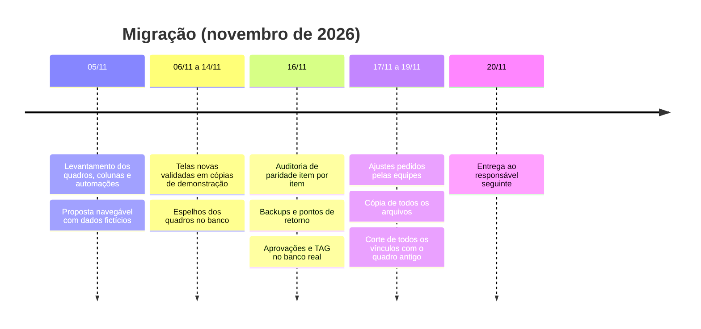
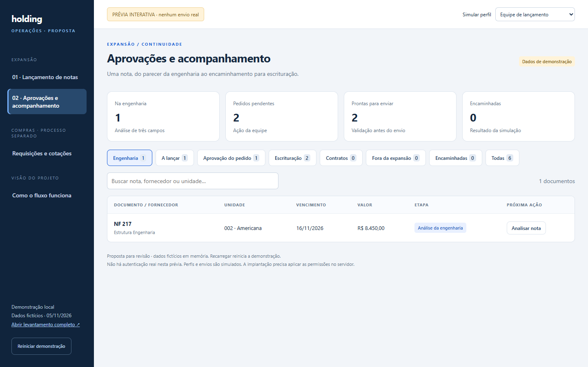

# 12 · Migração: do quadro SaaS para o sistema próprio

Até novembro de 2026, a aprovação das notas acontecia em quadros do **Monday.com**. O painel lançava as notas, e uma função do banco criava o item no quadro, com os arquivos. Também ficavam lá as etapas, os contratos, as requisições de compra, os projetos e as notas da TAG.

Em 15 dias, tudo isso passou para o sistema próprio, **sem parar o trabalho das equipes**.

## 1. Levantamento (05/11)

Para cada quadro, registrei:
- grupos, que viraram etapas;
- colunas, que viraram campos;
- automações, que viraram regras;
- quem mexia em quê.

As regras que só existiam na cabeça das pessoas foram perguntadas a quem fazia o trabalho. Compras, por exemplo, teve uma reunião só para isso, no primeiro dia.

O resultado foi uma **proposta navegável** em HTML, com dados fictícios. Cada equipe pôde clicar no fluxo antes de qualquer código de produção ([abrir a proposta](https://taveshu19.github.io/plataforma-notas-fiscais/proposta.html)).

## 2. Telas novas validadas em demonstração (06/11 a 14/11)

As áreas novas foram construídas sobre a interface de dados única ([02](02-arquitetura.md#2-uma-interface-de-dados-duas-implementações)). Cada equipe usava a **cópia de demonstração**, com o mesmo código e o banco falso, e pedia ajustes. As cores das unidades, por exemplo, ficaram iguais às do quadro antigo, para quem estava acostumado a elas.

## 3. Espelhos: o sistema antigo dentro do banco

Enquanto as decisões passavam para o painel, funções copiavam os quadros para tabelas do banco (`monday_espelho`, `monday_compras_espelho`, `contratos`, `projetos_*`). Os projetos eram atualizados a cada 5 minutos. Assim:
- o painel mostrava **tudo**, inclusive o que ainda estava só no quadro;
- notas antigas puderam receber a análise no painel. O gatilho `aprovacoes_completar` completa narrativa, contrato e pedido a partir da cópia;
- o retorno da escrituração encontrava a nota mesmo quando ela tinha nascido no quadro.

## 4. Auditoria de paridade (16/11)

Antes da virada, fiz uma lista do que o quadro fazia e de onde aquilo estava no painel: cada coluna, cada automação, cada e-mail. O que faltava virou tarefa. O que não seria levado foi decidido com quem usava.

## 5. Pontos de retorno e virada (16/11)

- Backup completo dos dois bancos.
- Cópia das páginas que estavam no ar.
- ID da versão publicada no Netlify, para voltar com um clique.
- Aprovações ligadas ao **banco real**.
- Painel da TAG com login obrigatório e dados no banco da Engenharia.

## 6. Arquivos

Os links de arquivo do quadro **expiram em poucas horas**. Por isso, as funções de cópia baixaram cada anexo para o Storage (`monday-arquivos`, `tag-arquivos`), e as notas passaram a apontar para a cópia. A função `arquivo-monday` entrega esses arquivos com a mesma regra de acesso da nota.

## 7. Corte (19/11)

Com tudo copiado e as equipes trabalhando no painel:
- as funções de espelho e cópia foram **apagadas**, e as chaves de acesso ao quadro foram removidas dos dois bancos;
- a escrituração, que antes era disparada pelo quadro, passou a sair do painel ([05](05-escrituracao.md));
- os textos das telas pararam de citar o sistema antigo (filtro `sem-monday.mjs`, aplicado ao HTML final). O que veio de lá aparece como "histórico".

A ferramenta antiga virou **arquivo morto**: nada no processo depende dela.

## 8. Entrega (20/11)

O sistema foi entregue ao responsável seguinte num pacote com:
- todo o código, montando sozinho;
- 11 documentos: mapa dos sistemas, como alterar e publicar, processos, pessoas e permissões, bancos, funções, contas e segredos (só os nomes), solução de problemas, pendências, histórico e o que ficou de fora;
- a lista do que trocar por segurança ([08](08-seguranca-e-privacidade.md#saída-do-desenvolvedor)).

## O que eu levaria para a próxima migração

- **Espelho antes de virada.** Ler o sistema antigo dentro do novo permitiu migrar por partes, sem data marcada para "tudo ou nada".
- **Paridade por escrito.** A lista do que o sistema antigo fazia foi o que impediu esquecer automações pequenas, como "comprovante incluído → pago".
- **Arquivos primeiro.** Links que expiram são a parte mais frágil de uma migração de SaaS.
- **Cortar de verdade.** Enquanto existia qualquer vínculo, alguém sugeria "corrige lá também". O corte completo acabou com a dúvida de onde está a verdade.
